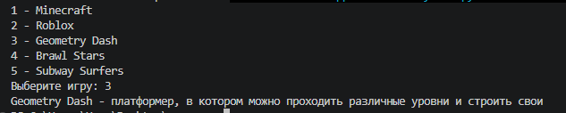
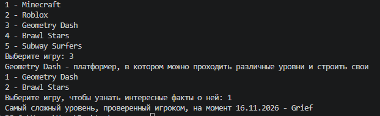
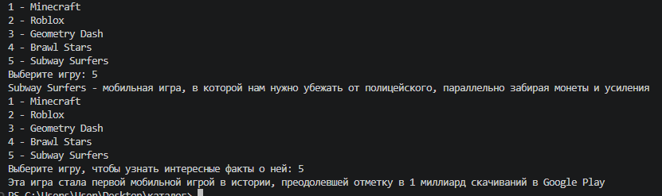

# Каталог игр

Программа нужна для людей, которые не могут выбрать, во что поиграть. Каталог показывает несколько игр, а при выборе одной из них показывает описание.

## Запуск

Откройте терминал в папке проекта. Для запуска последней версии выполните `python v3.py`. Если в Windows вы запускаете Python командой `py`, выполните `py v3.py`.

- [Первая версия](v1.py) — сделана
- [Вторая версия](v2.py) — …
- [Третья версия](v3.py) — …

## Команда

Запишите имена участников и кто чем занимался.
Пыжов Дмитрий - разработчик
Аймалетдинов Тимофей - тестировщик

## Помощь

Если вы хотите обратиться за помощью, то обратитесь к Дмитрию (профиль в GitHub - @halisu77)

## Спринт 1. План и первая версия

- **Цель первой версии:** показать каталог игр

| Что сделать | Кто делает | Сейчас или позже | Что получилось |
| Написать первую версию программы с 2 элементами | Пыжов Дмитрий | Сейчас | Получилось написать программу |
| Проверить работоспособность | Аймалетдинов Тимофей | Сейчас | Программа проверена |

- **Что показали в v1:** Готовую программу
- **Какое замечание получили:** Замечаний нет

## Скриншот первой версии

## Спринт 2. Доработка после показа

- **Какое замечание взяли из спринта 1:** Замечаний нет
- **Что изменим и как поймём, что готово:** Добавим факты. Мы поймём, что всё готово, после того, как факты будут корректно отображаться.
- **Кто пишет, кто проверяет:** Дмитрий пишет

| Что проверили | Что ожидали | Что увидели |
| Замечаний нет | Нормальную работоспособность программы | Всё соответствует требованиям |
| Новая функция | Показ интересных фактов | Фактов слишком мало |
| Функция из v1 | Показ каталога игр с выбором игры | Всё работает нормально |

- **Что поправили после показа:** Замечаний не было
- **Что вошло в v2:** Интересные факты об играх

## Скриншот второй версии

## Спринт 3. Запрос на изменение и выпуск

- **CR-1 (первый запрос на изменение):** кто попросил доработку и когда — тестировщик (Тимофей) попросил доработать факты
- **Что добавить и зачем:** Необходимо добавить ещё 3 интересных факта (для каждой игры по одному факту)
- **Как понять, что готово:** Факты должны отображаться корректно
- **Что затронет изменение:** Интересные факты
- **Что может сломаться и как это проверить:** Может сломаться поле с фактами. Проверить это можно, запустив программу и введя все цифры
- **Что согласовали и кто делает:** Мы согласовали добавление фактов. Делает это разработчик (Дмитрий)

| Что проверили | Что ожидали | Что увидели |
| Работоспособность программы | Программа должна отображать все факты | Всё соответствует требованиям |
| Действие из CR-1 | Новые факты | Всё работает корректно |
| Старая функция, которую он мог затронуть | Факты могли начать работать некорректно | Всё работает нормально |

- **Что вошло в v3:** Добавление трёх новых интересных фактов
- **Как пользоваться новой функцией:** После того, как мы выбрали игру, в консоли появится меню выбора. При выборе какой-то игры мы узнаём факт о ней.

**Скриншот v3.py.** Замените шаблонную картинку с тремя кубиками своим скриншотом. Покажите действие из запроса CR-1 и его результат.

## Скриншот третьей версии
# Pyzhov_Aymaletdinov_Sprints
